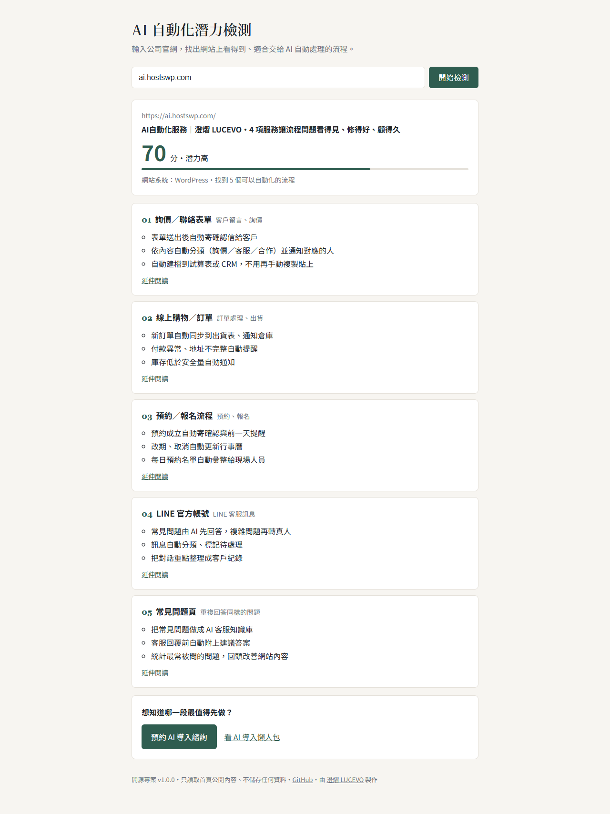
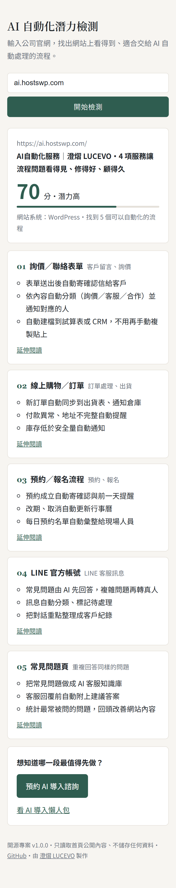

# AI 自動化潛力檢測：輸入官網，找出公司可以自動化的流程

**AI 自動化潛力檢測**（ai-automation-checker）是一個開源的 AI 導入評估工具：輸入一家公司的官網網址，它會讀取首頁公開內容，找出詢價表單、線上訂單、預約報名、LINE 客服、徵才、外語業務、產品型錄、多據點等「每天重複在做的流程」，給出 0–100 的 AI 自動化潛力分數，並針對每個流程列出可以怎麼用 AI 自動化。

適合想評估 **企業 AI 導入** 從哪裡開始的老闆、行銷與業務主管，也適合顧問、接案工程師拿來做 **流程自動化** 的第一輪盤點。



## 目錄

- [它會檢查什麼](#它會檢查什麼)
- [怎麼使用](#怎麼使用)
- [分數怎麼算](#分數怎麼算)
- [常見問題](#常見問題)
- [延伸閱讀：AI 導入怎麼開始](#延伸閱讀ai-導入怎麼開始)

## 它會檢查什麼

| 網站上的線索 | 代表的流程 | AI 自動化做法（舉例） |
|---|---|---|
| 詢價／聯絡表單 | 客戶留言、詢價 | 自動回覆確認信、依內容分類並通知負責人、自動建檔到 CRM |
| 線上購物／訂單 | 訂單處理、出貨 | 新訂單同步出貨表、付款異常提醒、庫存不足通知 |
| 預約／報名 | 預約、報名 | 確認與提醒信、改期同步行事曆、每日名單彙整 |
| LINE 官方帳號 | LINE 客服訊息 | AI 先回答常見問題、訊息分類、對話重點存成客戶紀錄 |
| 徵才／招募 | 履歷收件、面試安排 | 履歷整理成一覽表、初步篩選、面試通知 |
| 外語頁面 | 外語詢價、國際業務 | 外語信件翻譯摘要、多語產品資料 |
| 產品／型號多 | 產品資料、報價 | 規格知識庫、依詢價帶出型號與報價單草稿 |
| 多個據點 | 各據點報表 | 每日數字彙整、異常通知主管 |
| 常見問題頁 | 重複回答同樣的問題 | AI 客服知識庫、建議回覆 |
| 型錄／文件下載 | 文件整理與更新 | PDF 擷取成結構化資料、更新通知 |

另外會判斷網站是用什麼系統架設的（WordPress、Shopify、SHOPLINE、Wix…），方便評估要串接哪些工具。

## 怎麼使用

### 1. 命令列（Node.js 18 以上，不用安裝任何套件）

```bash
git clone https://github.com/yufan-code/ai-automation-checker.git
cd ai-automation-checker
node bin/cli.js example.com.tw
```

一次檢測多個網站、輸出 JSON：

```bash
node bin/cli.js site-a.com.tw site-b.com --json
```

### 2. 網頁版（部署到 Cloudflare Workers）

```bash
npx wrangler deploy
```

部署後打開網址就有輸入框；也可以直接呼叫 API：

```
GET /api/check?url=example.com.tw
```



### 3. 在自己的程式裡使用

```js
import { check } from "./src/checker.js";
const r = await check("example.com.tw");
console.log(r.score, r.level, r.signals.map(s => s.label));
```

## 分數怎麼算

基本分 20 分，每找到一個可自動化的流程加 10 分，最高 100 分。

- **60 分以上（高）**：網站上就有多個重複性流程，通常導入一兩條自動化就能明顯省下人工。
- **40–59 分（中）**：有一些可以先試的流程，建議從最常發生的那一條開始。
- **40 分以下（低）**：首頁看不出明顯的流程，不代表不適合 AI，建議從內部作業（報表、文件、客服）盤點。

分數只反映「官網上看得到的線索」，內部 ERP、Excel 報表、紙本作業看不到，實際導入前仍需要流程盤點。

## 常見問題

**會不會儲存我輸入的網址或檢測結果？**
不會。工具只在當下讀取一次首頁公開內容，不寫入任何資料庫。

**為什麼有些網站顯示「無法檢測」？**
部分網站有防火牆或機器人防護（HTTP 403／429／503），會擋掉自動讀取，這時請直接在瀏覽器打開網站，對照上面的表格自己檢查。

**分數高就一定要導入 AI 嗎？**
不一定。分數高代表「有重複流程」，要不要導入還要看每月發生次數、每次花多少時間，可以參考 [AI導入效益怎麼算](https://ai.hostswp.com/ai-adoption/roi/) 的試算方式。

**可以檢測內網或本機網站嗎？**
不行。為了安全，localhost、內網 IP 一律拒絕。

## 延伸閱讀：AI 導入怎麼開始

- [AI導入懶人包：費用、補助、流程重點一次看懂](https://ai.hostswp.com/ai-adoption/)
- [AI導入流程 6 階段：每一步做什麼、產出什麼](https://ai.hostswp.com/ai-adoption/process/)
- [AI導入案例：5 個部門的實際做法](https://ai.hostswp.com/ai-adoption/cases/)
- [AI自動化工作流案例：12 個產業示範](https://ai.hostswp.com/ai-automation-workflow-cases/)
- [AI導入工具怎麼選](https://ai.hostswp.com/ai-adoption/tools/)
- [流程盤點與接手：4 個欄位整理每一條流程](https://ai.hostswp.com/workflow-audit-handover/)

想知道你們公司哪一段流程最值得先自動化，可以 [預約 AI 導入諮詢](https://ai.hostswp.com/ai-consulting-2/)。

---

## English

**AI Automation Checker** scans a company website's homepage and detects repetitive workflows (inquiry forms, online orders, bookings, LINE chat, hiring, multilingual sales, product catalogs, multiple branches) that are good candidates for AI automation. It returns a 0–100 score with concrete automation ideas. Zero dependencies; runs on Node.js 18+ or Cloudflare Workers.

```bash
node bin/cli.js example.com --json
```

## 授權

MIT License。由 [澄熠 LUCEVO｜AI 自動化工作流規劃](https://ai.hostswp.com/) 製作與維護。
